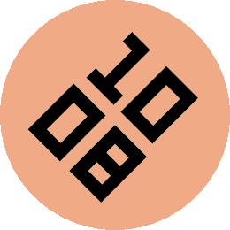

# Lean

*The time meets your eye at the angle your wrist comes to rest.*

     

A Pebble watchface (v1.0.0).

Every watch assumes you can turn your arm until the face lies straight in
front of you. Not everyone can. Lean turns the time instead of your arm:
raise your wrist the way you normally would, see how far the numbers are
off, and set that angle. From then on the time sits level when you glance
at it.

Worn on the left wrist the time turns clockwise, worn on the right it turns
counter-clockwise, anything from 0 to 90 degrees. One switch adds another
180 degrees for wearing the watch the other way round.

The time is set in LECO 1976, two lines, hours above minutes, drawn far
larger than the built-in version allows. There is no animation; the face is
drawn once a minute and then left alone.

## How the turning works

The Pebble SDK cannot draw rotated text. Lean draws the time upright as
usual, reads the digit pixels from the frame buffer into a 1-bit mask
(clearing them on the way), and writes them back rotated about the centre of
the screen. Each target pixel samples the mask at four points (2x2
supersampling) and is blended between digit and background colour, so the
edges stay smooth at any angle. On the rectangular screen the block is
scaled down if its turned corners would otherwise touch the edge.

## Settings

- Worn on - left wrist (clockwise) or right wrist (counter-clockwise).
- Tilt - 0 to 90 degrees in steps of 5.
- Worn upside down - adds 180 degrees. Leave it off if your watch already
  turns the whole display.
- Background - the face colour.
- Digits - the colour of the numerals.

12 or 24 hour format follows the watch setting.

## Platforms

- Pebble Time 2 (`emery`)
- Pebble Round 2 (`gabbro`)

## Building

With the [Pebble SDK](https://developer.repebble.com/sdk/):

```bash
pebble build
pebble install --emulator emery
```

The repository can also be imported into CloudPebble as is.

## Release notes

### 1.0.0

First release.

## License

MIT License, see [LICENSE](LICENSE). The bundled fonts are not covered by it and
remain under their own licenses.
